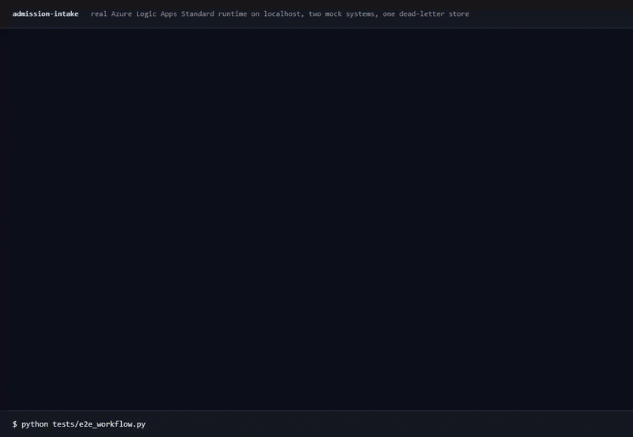
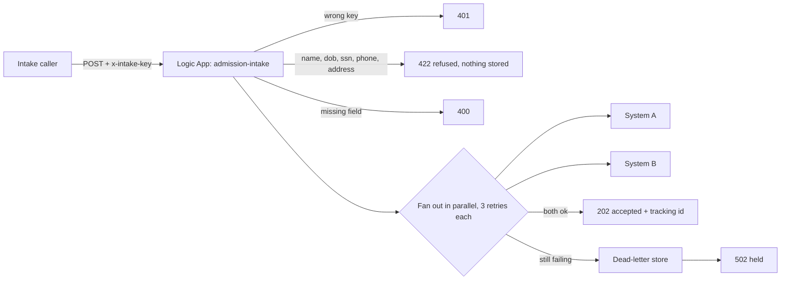
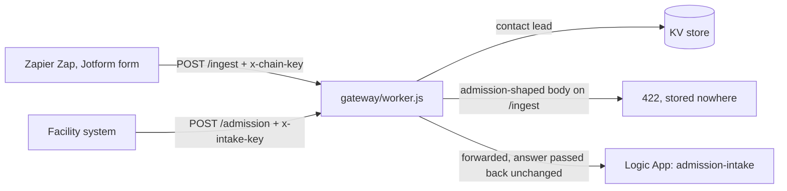
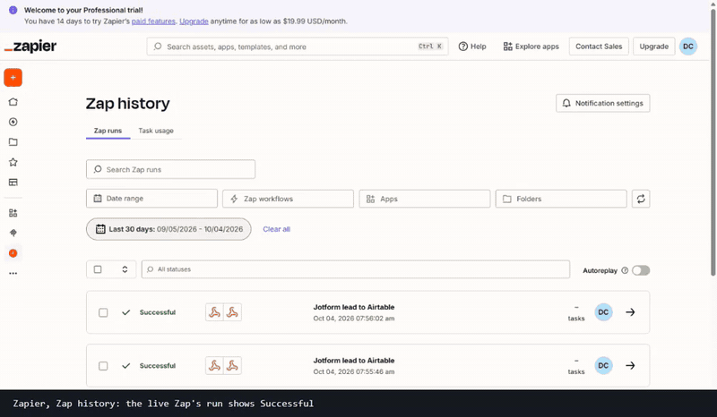

# Admission intake automation



Logic Apps workflow that writes one intake call to two systems safely: idempotent, retried, dead-lettered. A care coordinator used to re-key every new admission into two places and chase the confirmation; this is a Logic Apps workflow that does it in seconds on a happy path (not timed in this repo), refuses eight named identifier fields, and tells the caller the truth when a downstream system will not take it.

It is the "copying the same information into two systems" problem from a healthcare-IT job post, built and run on the **real Azure Logic Apps Standard runtime**, locally, against two mock systems.

Behind one Cloudflare Worker front door it has two lanes: admissions go to the Logic App, and contact leads from a Zapier Zap or a Jotform form go to a separate store. The Worker refuses to let one lane carry the other's data, and a test fails if the two lanes ever disagree about what an identifier is. See "One front door, two lanes".

## What it does



| Guarantee | How it is enforced |
|---|---|
| Unknown callers are refused | shared key compared to an app setting, 401 before anything else runs |
| No direct identifiers stored | 422 on eight named fields (`residentName`, `patientName`, `name`, `ssn`, `dob`, `dateOfBirth`, `phone`, `address`; exact, case sensitive, top level), and only five whitelisted fields are kept, so an unlisted field is dropped, not refused; the facility sends its own opaque `residentRef` |
| An admission is written once | `Idempotency-Key` on both writes; the mock systems dedupe on it, and a real system has to honour it |
| A flaky system is absorbed | fixed retry, 3 retries (up to 4 attempts), 5 seconds apart |
| A dead system is not silent | the record and failure detail go to a dead-letter store and the caller gets 502 `held` (if the dead-letter write also fails the caller still gets 502 and nothing is parked; not tested) |

## One front door, two lanes



| Rule | Where it is enforced |
|---|---|
| A contact lead is stored in the contact lane only | `gateway/worker.js`, `POST /ingest` |
| A body with an admission field (admissionId, facilityId, residentRef, admitDate, careLevel) or a clinical identifier (residentName, patientName, ssn, dob, dateOfBirth) is refused on `/ingest` with 422 | `classify()` in `gateway/worker.js` |
| An unknown caller never reaches the Logic App | 401 at the Worker, before any forward |
| The Logic App's own answer (202, 400, 401, 422, 502) reaches the caller unchanged | `admission()` in `gateway/worker.js` |
| The Worker and the Logic App agree on what an identifier is | `gateway/test/lanes.test.mjs` reads `workflow.json` and fails if either list changes alone |

A contact lead may carry a name, phone or address, which the Logic App refuses by design, so those three are listed as the deliberate overlap and the lanes are told apart by the admission fields and the clinical identifiers.

## The contact lane: Zapier, Jotform and Airtable



Two Zapier automations feed the contact lane, both built and tested with sample leads:

1. **Hook to gateway.** A lead POSTed to a **Zapier Catch Hook** is mapped by a Zap and POSTed to `/ingest` on the gateway, which stores it in KV and serves it back.
2. **Form to Airtable.** A **Jotform** form's webhook feeds a second Zap, which writes the lead into an **Airtable** table through Airtable's REST API.

| Part | What it does |
|---|---|
| `scripts/deploy_gateway.py` | Deploys `gateway/worker.js` to a Cloudflare account with a KV namespace and the key as a Worker secret; reuses the saved key on a redeploy so the Zap keeps working. Set `ADMISSION_URL` and `INTAKE_KEY` to switch the admission lane on |
| `scripts/contact-lane/airtable_setup.py` | Creates the "Lead intake lab" base and its Leads table (Name, Email, Message, Source) through Airtable's Metadata API; reuses it if it exists |
| `scripts/contact-lane/jotform_setup.py` | Creates the "Lead intake" form (Name, Email, Message) and attaches the Zap's Catch Hook as its webhook; `--submit` posts a test lead through the API |
| `scripts/contact-lane/e2e_check.py` | Sends a unique lead to Zap 1's hook, polls the gateway for exactly that lead and checks six things |
| `scripts/contact-lane/e2e_chain.py` | Submits a unique lead through the public Jotform form, polls Airtable for exactly that lead and checks five things (arrived within 120 s, name, email and message mapped, the Zap's fixed `source`) |
| `docs/ZAP.md` | The written spec of both Zaps, since a Zap is built in the editor and cannot be committed as code |

Measured 2026-10-04, when this lane was its own repository (merged here with its full history on 2026-10-22). Both Zaps were built in Zapier's editor, tested with the editor's own test step, published and then fired from outside: `e2e_check.py` passed 6 of 6 and `e2e_chain.py` 5 of 5, and Zap history lists the runs as Successful (the first frame of the clip above). The captured output is in `docs/contact-lane/`.

To run it you need your own Zapier account (the Webhooks app needs a paid plan or the trial), a Cloudflare account, a Jotform account, an Airtable account and Python 3:

```
python scripts/deploy_gateway.py                                    # prints the Worker URL
python scripts/contact-lane/airtable_setup.py <workspace id>        # prints the base and table ids
python scripts/contact-lane/jotform_setup.py <Zap 2 catch hook url> # prints the form id and URL
# build both Zaps as written in docs/ZAP.md, then:
ZAP_HOOK_URL=... RECEIVER_URL=... CHAIN_KEY=... python scripts/contact-lane/e2e_check.py
JOTFORM_FORM_ID=... AIRTABLE_BASE_ID=... AIRTABLE_TOKEN=... python scripts/contact-lane/e2e_chain.py
```

## Proof

`tests/e2e_workflow.py` drives the running workflow and checks the two mock systems and the runtime's own run history: **35 checks**, covering the happy path, both kinds of bad caller, five refused identifier fields, idempotency, a transient failure absorbed by retries (with the wait measured), and a permanent failure parked in the dead-letter store.

`gateway/test/lanes.test.mjs` is **12 unit tests** with a fake KV and a fake fetch, and `tests/e2e_gateway.mjs` is **14 checks** that run the Worker in front of the real Logic Apps runtime: an admission accepted and written once to both systems, a wrong key stopped at the edge, an identifier refused and stored nowhere, an admission sent to the contact lane refused, and a dead downstream coming back as 502 held. A planted defect (a new identifier added to the Worker's list only) makes two of the unit tests fail.

`scripts/mutation_check.py` breaks one guarantee at a time in `workflow.json`, restarts the runtime and expects the checks to fail: **6 of 6 caught** (last run in `docs/test-runs/mutation_check_last_run.txt`; dropping the ssn check, dropping the idempotency header, cutting retries, breaking the dead-letter path, removing the key check, making careLevel optional). The first run caught 5 of 6: a mock that accepted any URL let the broken dead-letter path through, so the mock now rejects wrong paths and the sixth is caught too.

## Run it

Needs Node, the .NET 8 SDK and Python 3. Run each of the first three commands in its own terminal and wait for the runtime's 'Host started' line; run the tests from the repository root. The mutation script is Windows only.

```
npm install -g azure-functions-core-tools@4 azurite
python mocks/mock_systems.py                                   # A=7801  B=7802  dead-letter=7803
azurite --silent --location .azurite                           # the storage the runtime keeps run history in
cd logicapp && func start --port 7071                          # the Logic Apps runtime
python tests/e2e_workflow.py                                   # 35 checks, last run saved in docs/test-runs/e2e_workflow_last_run.txt
node tests/e2e_gateway.mjs                                     # 14 checks, the Worker in front of the running workflow
python scripts/mutation_check.py                               # slow, restarts the runtime per mutant
node --test gateway/test/lanes.test.mjs                        # 12 unit tests, no runtime needed
```

Settings (the two system URLs, the dead-letter URL, the shared key) live in `logicapp/local.settings.json`, the same way an app setting would in Azure.

## Hours given back, the arithmetic

An illustration with stated assumptions, not a measurement: a facility admitting 40 residents a month, about 6 minutes to key one admission into one system, two systems. That is 40 x 6 x 2 = 480 minutes, **8 hours a month** returned to the floor per facility, before counting the time spent chasing a missed entry. Replace the three numbers with the facility's real ones to get its figure.

## Scope and next steps

- It runs on the local Logic Apps runtime against mock systems, and the Worker's `/admission` lane has been run against that local runtime. Next step: an Azure subscription and a public Logic App.
- The Worker deployed from the Zapier lab before this merge is the first version; running `scripts/deploy_gateway.py` again adds the contact-lane guard and the admission lane.
- Both Zaps are two steps and have run on sample leads. The Webhooks app is a Zapier premium app, so the Zaps keep running after the 14-day trial only on a paid plan, and the Airtable account is also on a trial. The gateway's KV records expire after seven days: the contact lane is a throwaway store, not a CRM.
- The Zaps are not in this repository because Zapier does not export one as code, so `docs/ZAP.md` is the spec. The Zaps post to Airtable's REST API with a webhook action rather than through Zapier's Airtable app, and the Jotform and Airtable accounts were created by hand because both sign-ups put a human check in front of automation.
- Next layer: a Power Apps screen for the coordinator.
- The design follows what a HIPAA review looks at first: one shared key, no stored identifiers, and a record of every hand-off.
- Partial success is visible, not undone: if A keeps failing and B succeeds, B keeps its record and the dead-letter entry names the side that failed. See `docs/DECISIONS.md` for why.
