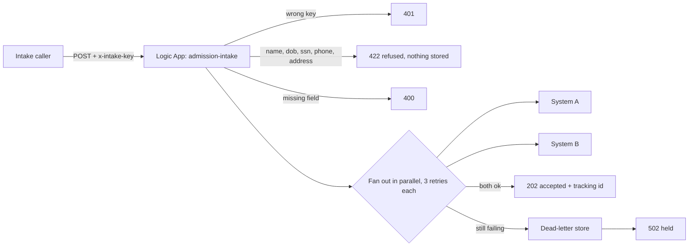

# Admission intake automation

One intake call, written once to two systems, safely. A care coordinator used to re-key every new admission into two places and chase the confirmation; this is a Logic Apps workflow that does it in seconds, refuses anything that could carry a resident's identity, and tells the caller the truth when a downstream system will not take it.

It is the "copying the same information into two systems" problem from a healthcare-IT job post, built and run on the **real Azure Logic Apps Standard runtime**, locally, against two mock systems. It has not been deployed to Azure and it is not production.

## What it does



| Guarantee | How it is enforced |
|---|---|
| Unknown callers are refused | shared key compared to an app setting, 401 before anything else runs |
| No direct identifiers ever stored | 422 on name, birth date, phone, address or social security number; the facility sends its own opaque `residentRef` |
| An admission is written once | `Idempotency-Key` on both writes, so a retried call never double-writes |
| A flaky system is absorbed | fixed retry, 3 attempts, 5 seconds apart |
| A dead system is not silent | the record and failure detail go to a dead-letter store and the caller gets 502 `held` |

## Proof

`tests/e2e_workflow.py` drives the running workflow and checks the two mock systems and the runtime's own run history: **35 checks**, covering the happy path, both kinds of bad caller, five refused identifier fields, idempotency, a transient failure absorbed by retries (with the wait measured), and a permanent failure parked in the dead-letter store.

`scripts/mutation_check.py` breaks one guarantee at a time in `workflow.json`, restarts the runtime and expects the checks to fail: **6 of 6 caught** (dropping the ssn check, dropping the idempotency header, cutting retries, breaking the dead-letter path, removing the key check, making careLevel optional). The first run caught 5 of 6: a mock that accepted any URL let the broken dead-letter path through, so the mock now rejects wrong paths and the sixth is caught too.

## Run it

Needs Node, the .NET 8 SDK and Python 3.

```
npm install -g azure-functions-core-tools@4 azurite
python mocks/mock_systems.py                                   # A=7801  B=7802  dead-letter=7803
azurite --silent --location .azurite                           # the storage the runtime keeps run history in
cd logicapp && func start --port 7071                          # the Logic Apps runtime
python tests/e2e_workflow.py                                   # 35 checks, about a minute
python scripts/mutation_check.py                               # slow, restarts the runtime per mutant
```

Settings (the two system URLs, the dead-letter URL, the shared key) live in `logicapp/local.settings.json`, the same way an app setting would in Azure.

## Hours given back, the arithmetic

An illustration with stated assumptions, not a measurement: a facility admitting 40 residents a month, about 6 minutes to key one admission into one system, two systems. That is 40 x 6 x 2 = 480 minutes, **8 hours a month** returned to the floor per facility, before counting the time spent chasing a missed entry. Replace the three numbers with the facility's real ones to get its figure.

## Limits, stated plainly

- Local runtime and mock systems only. Not deployed to an Azure subscription.
- No front end. A Power Apps screen for the coordinator is the obvious next layer.
- Not production, and not claimed to be HIPAA compliant. The design follows what a HIPAA review looks at first: least privilege, no stored identifiers, and a record of every hand-off.
- Partial success is visible, not undone: if A keeps failing and B succeeds, B keeps its record and the dead-letter entry names the side that failed. See `docs/DECISIONS.md` for why.
